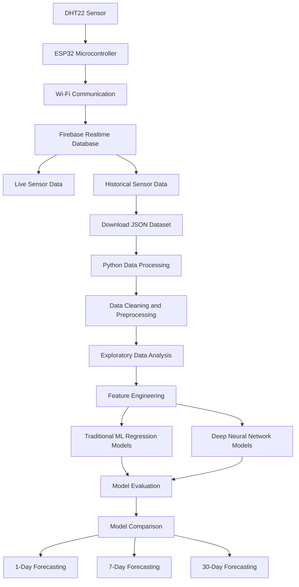

# 03. System Architecture

## 3.1 Overview

The project follows an end-to-end IoT and Machine Learning architecture that integrates hardware components, cloud database storage, data processing, analytics, and predictive modeling.

The system is divided into five major layers:

1. Sensor and Hardware Layer
2. Data Communication Layer
3. Cloud Storage Layer
4. Data Analytics and Processing Layer
5. Machine Learning and Deep Learning Layer

Each layer performs a specific function and communicates with the next layer to achieve the overall project objective.

## 3.2 System Architecture Diagram



## 3.3 Architecture Components

### Layer 1: Sensor and Hardware Layer

**Components:**
- ESP32 microcontroller
- DHT22 temperature and humidity sensor

**Working:**

The DHT22 sensor measures environmental temperature and relative humidity.

The sensor is connected to the ESP32 through a digital data pin. The ESP32 reads the sensor values at regular intervals.

**Responsibilities:**
- Measure temperature in Celsius.
- Measure relative humidity in percentage.
- Check sensor reading validity.
- Generate timestamps for sensor readings.
- Prepare sensor data for cloud transmission.

**Current implementation:**
- Sensor: DHT22
- Microcontroller: ESP32
- Sensor data pin: GPIO 4
- Data collection interval: 2 seconds

### Layer 2: Data Communication Layer

**Technology:** Wi-Fi

The ESP32 uses Wi-Fi connectivity to communicate with Firebase Realtime Database.

**Working:**

1. ESP32 connects to the configured Wi-Fi network.
2. Sensor readings are collected.
3. The readings are formatted into JSON.
4. The JSON data is transmitted to Firebase.
5. If connectivity is unavailable, records are temporarily stored in an offline queue.

**Offline handling:**

The current implementation maintains an offline queue with a maximum capacity of 100 records in ESP32 RAM.

When connectivity is restored, queued records are uploaded to Firebase.

Note: Since the current queue uses RAM, queued records may be lost if the ESP32 loses power or restarts before uploading them.

### Layer 3: Cloud Storage Layer

**Technology:** Firebase Realtime Database

Firebase Realtime Database is used for storing live sensor information and historical sensor readings.

The database contains two primary root nodes.

**A. Live Sensor Data**

Path: `/01_live_sensor`

Stores the latest sensor information.

Example:

```json
{
  "device": "dht22-esp32",
  "humidity": 67.2,
  "status": true,
  "temperature": 30.2
}
```

**B. Historical Sensor Data**

Path: `/02_history`

Stores individual sensor readings using Firebase-generated unique record IDs.

Example:

```json
{
  "-P6Ye-vdBjOEnMCBtTHU": {
    "humidity": 67.6,
    "status": true,
    "temperature": 30.2,
    "timestamp": 1794820803000
  }
}
```

**Historical data fields:**

| Field | Description |
|---|---|
| record_id | Firebase-generated unique identifier |
| temperature | Temperature in Celsius |
| humidity | Relative humidity in percentage |
| status | Indicates whether the sensor reading is valid |
| timestamp | Unix timestamp in milliseconds |

When a sensor reading fails, temperature and humidity are stored as JSON `null`, and status is stored as `false`.

### Layer 4: Data Analytics and Processing Layer

**Technology:** Python

Historical sensor data is downloaded from Firebase in JSON format and converted into structured CSV or Excel datasets.

**Processing workflow:**

1. Download historical JSON data from Firebase.
2. Extract records from `/02_history`.
3. Convert nested JSON records into tabular format.
4. Preserve the Firebase record ID and original timestamp.
5. Handle missing and invalid sensor values.
6. Check duplicate records and data consistency.
7. Perform exploratory data analysis.
8. Visualize temperature and humidity trends.

**Expected dataset structure:**

| record_id | humidity | status | temperature | timestamp |
|---|---:|---|---:|---:|
| Record 1 | 67.6 | TRUE | 30.2 | 1794820803000 |
| Record 2 | 67.6 | TRUE | 30.2 | 1794820805000 |
| Record 3 | 67.5 | TRUE | 30.2 | 1794820807000 |

**Python libraries:**
- Pandas
- NumPy
- Matplotlib
- Seaborn

### Layer 5: Machine Learning and Deep Learning Layer

This layer uses the processed historical dataset to develop predictive models for temperature and humidity forecasting.

**A. Traditional Machine Learning**

Algorithms can include:

- Linear Regression
- Multiple Linear Regression
- Polynomial Regression
- Decision Tree Regression
- Random Forest Regression
- Gradient Boosting Regression

The models will be trained and evaluated to identify suitable approaches for the forecasting tasks.

**B. Deep Neural Networks (DNN)**

Technology: TensorFlow / Keras

Deep Neural Networks will be implemented to learn patterns from historical temperature and humidity data.

The DNN models will be evaluated against traditional ML regression models.

**C. Forecasting Tasks**

The project focuses on three forecasting horizons:

| Forecasting Task | Objective |
|---|---|
| 1-Day Forecasting | Predict future temperature and humidity over a 1-day horizon |
| 7-Day Forecasting | Predict future temperature and humidity over a 7-day horizon |
| 30-Day Forecasting | Predict future temperature and humidity over a 30-day horizon |

Each forecasting task will be treated as a separate experiment with appropriate training, validation, and testing procedures.

### 3.4 Model Evaluation

Traditional ML and DNN models will be evaluated using regression performance metrics.

| Metric | Purpose |
|---|---|
| MAE | Measures average absolute prediction error |
| MSE | Measures average squared prediction error |
| RMSE | Measures prediction error in the original target unit |
| R² Score | Measures the proportion of target variance explained by the model |

Model performance will be compared separately for temperature and humidity.

### 3.5 Complete Data Flow

The complete system follows this sequence:

1. DHT22 measures temperature and humidity.
2. ESP32 reads the sensor values.
3. ESP32 generates a timestamp.
4. ESP32 sends the readings to Firebase through Wi-Fi.
5. Firebase maintains live and historical sensor data.
6. Historical JSON data is downloaded from Firebase.
7. Python converts JSON into CSV and Excel datasets.
8. Data cleaning and preprocessing are performed.
9. Exploratory Data Analysis identifies patterns and trends.
10. Feature engineering prepares data for forecasting.
11. Traditional ML and DNN models are developed.
12. Models are evaluated using regression metrics.
13. Forecasting results are generated for 1-day, 7-day, and 30-day horizons.

### 3.6 Technology Stack

| Layer | Technology |
|---|---|
| Sensor | DHT22 |
| Microcontroller | ESP32 |
| Communication | Wi-Fi |
| Cloud Database | Firebase Realtime Database |
| Programming Language | Python |
| Development Environment | VS Code / Jupyter Notebook |
| Data Processing | Pandas, NumPy |
| Data Visualization | Matplotlib, Seaborn |
| Machine Learning | Scikit-learn |
| Deep Learning | TensorFlow / Keras |
| Dataset Format | JSON, CSV, Excel |

### 3.7 Architecture Summary

The proposed architecture combines IoT hardware, cloud-based data storage, Python-based data analytics, traditional Machine Learning, and Deep Neural Networks.

The ESP32 and DHT22 handle environmental data collection, Firebase provides cloud storage, and Python handles data processing and predictive model development.

The final system aims to establish a complete workflow from real-time environmental monitoring to historical data analysis and future temperature and humidity forecasting.